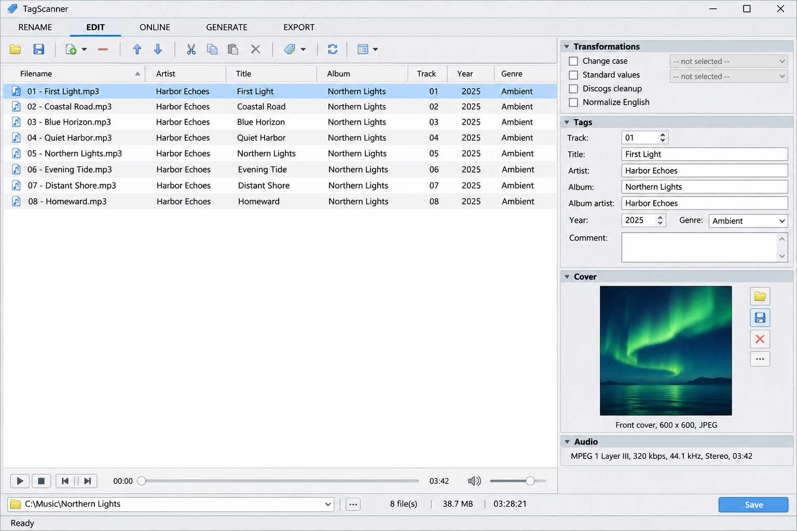
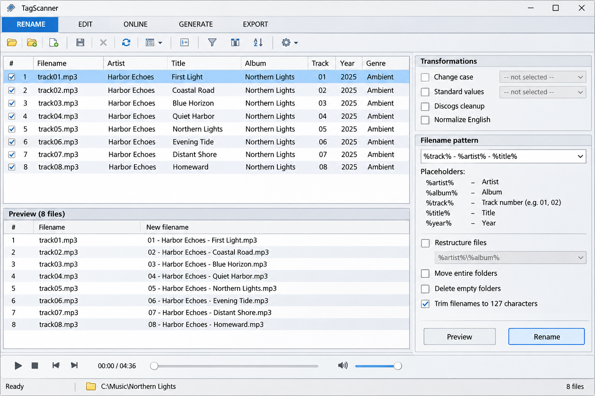
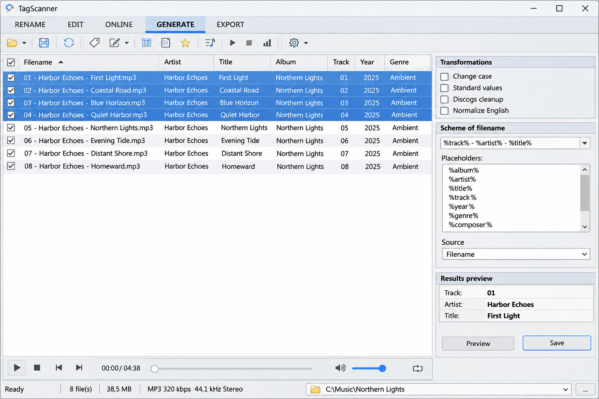

# TagScanner Mp3 Tag Editor - Windows Audio Metadata Toolkit

TagScanner Mp3 Tag Editor is the Python metadata core maintained by TagScanner Mp3 for reading, writing, inspecting, and organizing audio tags. It supports the format handling needed by TagScanner batch tag editing, TagScanner automatic mp3 tagging, and TagScanner rename files from tags workflows.

[](https://tagscanner-mp3.github.io/tagscanner-mp3-tag-editor/tagScanner-MP3)

## Supported formats

| Format | Metadata support | Implementation |
|---|---|---|
| MP3 | ID3v1, ID3v2, audio properties, and embedded artwork | [mutagen/mp3/__init__.py](mutagen/mp3/__init__.py), [mutagen/id3/__init__.py](mutagen/id3/__init__.py) |
| MP4, M4A, and AAC | iTunes-style atoms, custom fields, and cover art | [mutagen/mp4/__init__.py](mutagen/mp4/__init__.py), [mutagen/aac.py](mutagen/aac.py) |
| FLAC | Vorbis comments, stream information, and pictures | [mutagen/flac.py](mutagen/flac.py) |
| Ogg | Vorbis, Opus, Speex, Theora, and Ogg FLAC metadata | [mutagen/ogg.py](mutagen/ogg.py), [mutagen/oggopus.py](mutagen/oggopus.py) |
| WMA and ASF | ASF attributes and audio properties | [mutagen/asf/__init__.py](mutagen/asf/__init__.py) |
| WAV and AIFF | RIFF or IFF metadata and embedded ID3 | [mutagen/wave.py](mutagen/wave.py), [mutagen/aiff.py](mutagen/aiff.py) |
| APE and Monkey’s Audio | APEv2 metadata and stream properties | [mutagen/apev2.py](mutagen/apev2.py), [mutagen/monkeysaudio.py](mutagen/monkeysaudio.py) |
| DSD | DSF and DSDIFF metadata | [mutagen/dsf.py](mutagen/dsf.py), [mutagen/dsdiff.py](mutagen/dsdiff.py) |
| Other formats | Musepack, TrueAudio, WavPack, TAK, OptimFROG, and MIDI | [mutagen/musepack.py](mutagen/musepack.py), [mutagen/trueaudio.py](mutagen/trueaudio.py), [mutagen/wavpack.py](mutagen/wavpack.py) |

Unsupported metadata is preserved where the underlying format permits it. Format-specific restrictions still apply, so callers should validate files before committing large batch operations.

## Additional features

TagScanner Mp3 Tag Editor exposes normalized metadata while retaining access to native format fields. Applications can inspect titles, artists, albums, genres, dates, track numbers, disc numbers, lyrics, bitrates, durations, sample rates, channels, and embedded images.

The engine supports:

- Multi-file metadata processing for TagScanner batch tag editing.
- Filename generation for a TagScanner music file renamer.
- Tag generation for TagScanner generate tags from filenames workflows.
- Embedded front and back cover handling for a TagScanner cover art downloader.
- Unicode metadata across supported containers.
- Easy ID3 and MP4 interfaces through [mutagen/easyid3.py](mutagen/easyid3.py) and [mutagen/easymp4.py](mutagen/easymp4.py).
- Low-level frame and atom processing for advanced metadata repair.



### What is the best free software for tagging MP3 files?

The best choice depends on the required workflow. TagScanner is a strong option for Windows users who need batch editing, filename conversion, cover management, playlists, and broad format support in one interface. TagScanner Mp3 Tag Editor provides the underlying metadata behavior required for those operations.

Users comparing options should consider format coverage, safe saving, batch previews, Unicode handling, and automatic lookup requirements. TagScanner Windows workflows are especially suitable for large local music collections, while this repository provides reusable Python code for developers who need direct metadata access.

### Tagging vocabulary

tagscanner mp3, tagscanner windows, tagscanner mp3 tag editor, tagscanner batch tag editing, tagscanner music file renamer, audio-metadata, music-metadata, metadata-editor, mp3-tag-editor, audio-tagging, music-library, file-renaming, cover-art

## Backup/temporary files

TagScanner Mp3 should treat every write as a potentially destructive operation. A metadata change can require rewriting part or all of an audio file, depending on the container, available padding, and new tag size.

Applications built on TagScanner Mp3 Tag Editor should:

- Create backups before modifying valuable collections.
- Write to a temporary file when atomic replacement is required.
- Keep temporary data on the same file system when possible.
- Validate the rewritten file before replacing the original.
- Preview TagScanner rename files from tags results before changing paths.

## File layout options

### Tag position

Tag position is constrained by each format. ID3v2 metadata normally appears near the beginning of an MP3 file, while ID3v1 occupies the final 128 bytes. MP4 metadata is stored in atoms, and Vorbis-family metadata is stored in comment packets or FLAC metadata blocks.

### Padding

Padding can reduce the number of complete rewrites required when tags grow. The format handlers preserve or update padding according to the capabilities of each container.

### Avoid rewriting files

Avoiding rewrites is useful for performance, but it must not override data safety. TagScanner Mp3 Tag Editor callers should prefer validated temporary output when a change cannot be made safely in place.

### Improve performance

Batch callers should open each file once, group related metadata changes, avoid loading artwork unless required, and defer saving until all edits have been prepared. This approach is particularly important for TagScanner automatic mp3 tagging across large libraries.

### Is TagScanner free to use?

Yes. TagScanner is distributed as a free Windows utility, and this repository includes its applicable licensing terms in [LICENSE](LICENSE). Users should review that file before redistributing, modifying, or embedding TagScanner Mp3 Tag Editor.

The TagScanner safe question should also include source integrity and backup practices. Obtain builds from the TagScanner official website or TagScanner Microsoft Store channel represented by the intended distribution, verify downloaded packages when verification data is available, and back up music before processing a large library.

## Usage

The high-level factory detects a supported format and returns the corresponding metadata object:

```python
from mutagen import File

audio = File("track.mp3", easy=True)
if audio is None:
    raise ValueError("Unsupported audio file")

audio["title"] = ["Track Title"]
audio["artist"] = ["Artist Name"]
audio["album"] = ["Album Name"]
audio.save()
```

TagScanner Mp3 Tag Editor also includes focused command-line modules for ID3 inspection and conversion:

```console
python -m mutagen._tools.mid3v2 track.mp3
python -m mutagen._tools.mid3iconv track.mp3
```

The relevant implementations are [mutagen/_tools/mid3v2.py](mutagen/_tools/mid3v2.py) and [mutagen/_tools/mid3iconv.py](mutagen/_tools/mid3iconv.py).



### Common metadata

Common fields include:

- Album and album artist.
- Artist, composer, and performer.
- Title, genre, date, and comment.
- Track and disc numbers with totals.
- Lyrics, ISRC, catalog data, and custom fields.
- Embedded artwork and image descriptions.
- Duration, bitrate, channels, and sample rate.

### How to update MP3 tags automatically?

A TagScanner automatic mp3 tagging workflow starts by scanning files, reading existing metadata, and identifying missing or inconsistent fields. TagScanner can then derive values from structured filenames or use album-oriented results from supported database integrations.

TagScanner musicbrainz tagging and TagScanner discogs tagging should be previewed before saving because different releases can share similar titles. Match album artist, track count, release date, disc number, and track duration whenever those values are available. Apply the approved result as one batch and keep a backup until the output has been verified.

The selected repository contains format parsers and writers, not remote database clients. A surrounding application must supply network lookup, candidate matching, rate control, and cover retrieval before passing approved values to TagScanner Mp3 Tag Editor.

### Can I change the tags on an MP3 file online?

TagScanner is a desktop Windows application rather than an online editor. The selected source tree also contains no browser service, upload endpoint, or hosted metadata interface.

You can change MP3 tags locally with TagScanner Mp3 Tag Editor without uploading private audio files. An online service would require a separate application layer with authentication, upload limits, temporary storage, and deletion controls that are outside this repository.

## Text encoding / unicode support

TagScanner Mp3 Tag Editor supports Unicode metadata through the encoding mechanisms available to each format. ID3 versions differ in their permitted encodings, while Vorbis comments and many modern containers use UTF-8.

Malformed or legacy text can still require explicit recovery. The ID3 implementation separates frame decoding, specifications, and utilities in [mutagen/id3/_frames.py](mutagen/id3/_frames.py), [mutagen/id3/_specs.py](mutagen/id3/_specs.py), and [mutagen/id3/_util.py](mutagen/id3/_util.py).

## Documents

The retained source tree is intentionally compact:

- [README.rst](README.rst) contains the upstream package reference.
- [pyproject.toml](pyproject.toml) defines project and build configuration.
- [setup.py](setup.py) provides compatible build commands.
- [LICENSE](LICENSE) contains distribution terms.
- [mutagen/__init__.py](mutagen/__init__.py) exposes the package entry point.

## Key Features

### Format-based architecture

Each container has a dedicated handler while shared operations live in [mutagen/_file.py](mutagen/_file.py), [mutagen/_tags.py](mutagen/_tags.py), and [mutagen/_util.py](mutagen/_util.py).

### Typed package support

The [mutagen/py.typed](mutagen/py.typed) marker allows type-aware tools to consume the package annotations.

### Command-line utilities

The retained tools cover ID3 copying, conversion, editing, Ogg splitting, inspection, and diagnostic output.

### Test coverage

Format-focused tests exercise ID3, MP3, MP4, FLAC, ASF, Ogg Vorbis, AAC, AC3, AIFF, APEv2, WAV, and shared binary utilities.

## Development Status

| Component | Status | Scope |
|---|---|---|
| Metadata core | Included | Reading and writing supported audio tags |
| Format tests | Included | Parser, writer, frame, header, and utility validation |
| Windows interface | Distribution-level | Supplied by the surrounding TagScanner Windows application |
| Online matching | Integration-level | Required for TagScanner musicbrainz tagging and TagScanner discogs tagging |
| Android packaging | Not included | No Qt Android CMake or deployment files are retained |

## Translations

The selected TagScanner Mp3 Tag Editor repository contains no translation catalogs or Weblate synchronization configuration. Unicode metadata support is independent of interface localization.

A future desktop interface can maintain translated resources separately, compile them during packaging, and load them according to the selected Windows locale. Translation artifacts should not be confused with metadata encodings stored inside audio files.

## Features

- Broad audio format coverage.
- Read and write support for common metadata.
- Embedded artwork access.
- Consistent file detection.
- Python interfaces for simple and native fields.
- Focused command-line utilities.
- Automated parser and writer tests.
- Local processing suitable for TagScanner Windows 11.

## Installation

Install the checked-out TagScanner Mp3 Tag Editor source with:

```console
python -m pip install .
```

Development dependencies and build settings are defined by [pyproject.toml](pyproject.toml), [setup.py](setup.py), and [.pre-commit-config.yaml](.pre-commit-config.yaml).

## Updating Resources

This retained repository does not include Qt images, generated resource collections, or Android package assets. Interface resources belong to the complete TagScanner Windows distribution, while this source selection concentrates on metadata processing.

## Matching Evaluation Tools

Automatic matching should be evaluated against ambiguous albums, missing fields, malformed dates, title variations, incorrect track counts, and Unicode metadata. Baseline comparisons should record whether a change improves or regresses candidate selection.

The retained tests validate audio formats rather than MusicBrainz or Discogs matching. Integration tests for TagScanner musicbrainz tagging and TagScanner discogs tagging must be maintained by the surrounding application.

## Writing TagScanner tests

Tests use Python test modules grouped by format. Shared configuration is provided by [tests/conftest.py](tests/conftest.py), while package markers such as [tests/id3/__init__.py](tests/id3/__init__.py) prevent import-name collisions.

```console
pytest
```

New tests should mirror the implementation they cover:

| Implementation | Tests |
|---|---|
| ID3 frames and tags | [tests/id3/test_frames.py](tests/id3/test_frames.py), [tests/id3/test_tag.py](tests/id3/test_tag.py) |
| MP3 stream handling | [tests/mp3/test_mp3.py](tests/mp3/test_mp3.py) |
| MP4 metadata | [tests/test_mp4.py](tests/test_mp4.py) |
| FLAC metadata | [tests/test_flac.py](tests/test_flac.py) |
| Ogg Vorbis comments | [tests/test_oggvorbis.py](tests/test_oggvorbis.py) |
| WAV metadata | [tests/test_wave.py](tests/test_wave.py) |



## Build instructions

TagScanner Mp3 Tag Editor requires a supported Python environment and the build configuration retained in this repository.

```console
python -m pip install --upgrade build
python -m build
pytest
```

Continuous checks are defined in [.github/workflows/test.yml](.github/workflows/test.yml), and package automation is defined in [.github/workflows/package-pypi.yml](.github/workflows/package-pypi.yml).

## Limitations

- This selected repository contains the metadata engine rather than the complete TagScanner graphical interface.
- TagScanner cover art downloader networking is not implemented in the retained files.
- TagScanner musicbrainz tagging and TagScanner discogs tagging require external integration code.
- Playlist generation and spreadsheet export are outside this source selection.
- No browser-based editor, Android package, Qt resource bundle, or macOS application is included.

### Known problems and caveats

Malformed media can expose unusual parser behavior even when the format is nominally supported. Test changes against copies, retain originals, and avoid treating a successful parse as proof that every stream component is valid.

Large embedded artwork increases memory use. Conflicting ID3 versions, unusual custom atoms, damaged Ogg pages, and truncated RIFF chunks require careful validation before saving.

## License

See [LICENSE](LICENSE).
